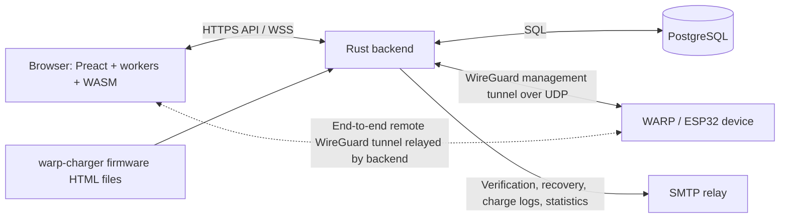
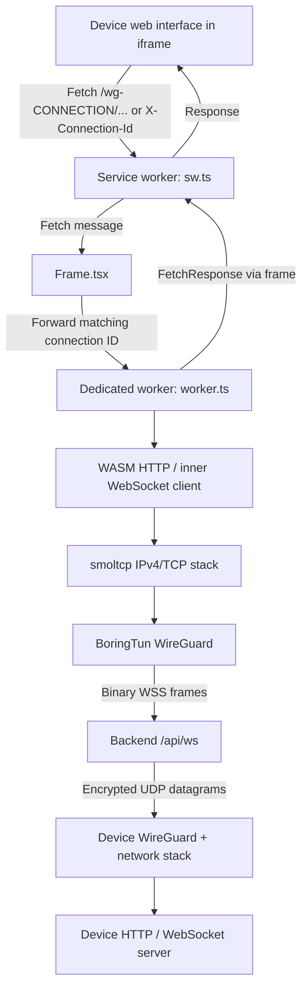
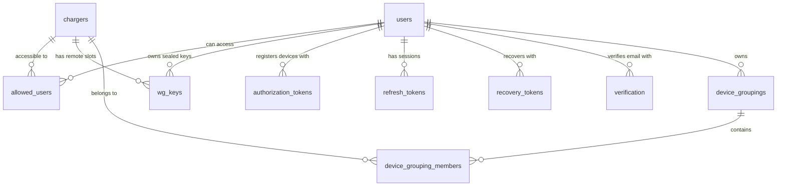

# Architecture and entity relationships

## Components and trust boundaries

The backend serves the Preact application and `/api` over HTTPS (debug: 8081,
release: 443), and listens on UDP 51820. PostgreSQL stores accounts, device
registrations, encrypted user/device data and tokens.

Two kinds of WireGuard connection share the UDP listener:

- A **management tunnel** terminates at the backend. The server uses it for
  connect/disconnect commands, user-removal commands and charge-log transfer.
- A **remote tunnel** terminates in the user's browser and the device. The
  backend forwards its encrypted packets between a WebSocket and the discovered
  device UDP endpoint; it does not terminate this tunnel.

Account names and emails are server-readable text. Account private
keys are password-encrypted; browser WireGuard private keys, remote PSKs,
per-user device names/notes, grouping names and token names are sealed to the
user's public key. Management keys are available to the backend. See
[data_type_definitions.md](data_type_definitions.md) for exact formats.

## Browser request path

`Frame.tsx` owns an iframe and a dedicated worker for the selected device.
`sw.ts` is the service worker registered as `/sw.js`; it intercepts `/wg-...`
requests and requests tagged with `X-Connection-Id`. Messages contain request
IDs and connection IDs so the frame can route them to the correct worker.

Response traffic follows the reverse network path. The device's inner WebSocket
is handled by WASM and forwarded through worker/frame messages to the iframe.
For the initial interface, the service worker first tries the authenticated
`/api/webinterface?charger=UUID` endpoint. It serves a matching firmware HTML
file, which the service worker decompresses as gzip. Missing files fall back to
the tunneled device request. Firmware filenames replace `.` and `+` in the
reported version with `_` and append `_index.html`.

The service worker also stores the derived account-encryption key in Cache
Storage and coalesces successful JWT refresh responses for three minutes.
`index.tsx` refreshes authentication periodically and checks `version.json` every
ten minutes to offer a reload after a deployment.

## Device list and native app bridges

The device list merges its cloud WebSocket data with LAN discovery results when
the native wrapper provides `window.tinkerforge_discovery`. The frontend does
not perform LAN discovery itself. Matching nonzero hardware UIDs merge into one
entry; local-only entries have an empty cloud UUID and cannot be removed from an
account or given server-stored notes. A device's cloud registration and its
current LAN reachability are independent.

Connect prefers the local path when a discovered host is available. Devices
with both paths show a menu for local or cloud access. Local navigation calls
the native bridge's `navigateToCharger(host)`; cloud navigation opens
`/devices/DEVICE_UUID` and starts the workers/tunnel described above. The frontend
also retains `/chargers` and `/chargers/DEVICE_UUID/...` routes for old bookmarks.

The native contracts are declared in
[window.d.ts](frontend/src/types/window.d.ts):

| Bridge | Frontend use |
| --- | --- |
| `tinkerforge_discovery` | Start/stop discovery, receive `onWarpChargersChanged` and `onWarpDiscoveryStopped`, navigate to a discovered device |
| `tinkerforge_provisioning` | Start QR provisioning and receive failure/cancellation callbacks; panels require `isSupported()` |
| `tinkerforge_devices` | Optional native `resetToDevices()` hook declared for wrapper integrations |

The logged-out page exposes local discovery/provisioning inside the WARP app;
the logged-in device list also integrates the available bridges. Native bridge
implementations and platform permissions are outside this repository. In a
regular browser without those bridges, remote access uses the cloud path and
the native provisioning panel is hidden. The Median bridge supplies app menus,
downloads and resume callbacks; WARP/SEB user-agent markers identify app variants.

Groups support a default filter and an optional grouped presentation. The
default is loaded from the server; the grouped-view preference is stored locally
as `groupByEnabled`. Search operates on decrypted names/notes and other device
metadata. Unknown registration dates remain last when sorting in either
direction. Losing the account secret makes sealed names, notes and group names
unreadable as well as preventing decryption of remote keys.

Implementation: [Devices.tsx](frontend/src/pages/Devices.tsx),
[LocalDevices.tsx](frontend/src/components/LocalDevices.tsx),
[Provisioning.tsx](frontend/src/components/Provisioning.tsx),
[GroupingModal.tsx](frontend/src/components/device/GroupingModal.tsx).

## Relay state

Persistent data lives in PostgreSQL; live network state lives in `BridgeState`
and `AppState`. In-memory maps track management tunnels by device UUID and source
socket address, pending discovery responses, remote connection slots, WebSocket
sessions and keys currently in use.

An authenticated `PUT /api/management` associates a device with its observed
source IP and reconciles configured users. UDP handshake matching uses those
candidates, nearby subnet candidates, forwarding-host candidates or a
rate-limited global search. Management tunnel expiry and discovery cleanup run
periodically; device connected/disconnected state is pushed to subscribed
browsers through a separate `/api/charger/get_devices` WebSocket.

The relay maps and key reservations are process-local. Restarting the backend
loses live sessions and requires reconnection; the current code does not share
those maps between backend instances.

Implementation: [main.rs](backend/src/main.rs),
[ws_udp_bridge.rs](backend/src/ws_udp_bridge.rs),
[udp_server](backend/src/udp_server/mod.rs),
[Frame.tsx](frontend/src/pages/Frame.tsx),
[wg-webclient](wg-webclient/src/wg_client.rs).

## Database relationships

- `users` holds plaintext account metadata, a login-key hash, salts and the
  encrypted account secret/nonce, plus email-change rollback fields.
- `chargers` represents all supported device types despite the historical name.
  It holds the hardware UID, UUID, management credentials, reported web port,
  firmware/type/MTU, last state-change timestamp and recent charge-log hashes.
- `allowed_users` has one row per `(user_id, charger_id)`. It holds per-user
  encrypted name/note, the `valid` flag and nullable `added_at`; old associations
  have unknown add times. There is no `is_owner` field.
- `wg_keys` belongs to a user/device pair and stores each remote connection
  slot's keys and addresses. There is no persistent `in_use` field.
- `device_groupings` belongs to a user. A partial unique index permits at most
  one `is_default=true` grouping per user. Membership pairs are unique and
  cascade on grouping/device deletion. Groups organize the list; they do not
  grant access to a device. The frontend seals group names to the account key.
- Authorization tokens carry use-once flags and creation/last-use timestamps.
  Refresh and recovery tokens and verification rows serve separate purposes.

Deleting a user cascades to their device access rows, WireGuard keys, all token
and verification records, and device groupings, including grouping memberships.
Shared device records and other users' data remain intact. The account deletion
endpoint also removes devices left without any allowed users.

The source of truth is [schema.rs](db_connector/src/schema.rs),
[models](db_connector/src/models/mod.rs) and the ordered
[migrations](db_connector/migrations). Startup applies embedded migrations;
normal application queries use a `diesel-async` PostgreSQL pool.
