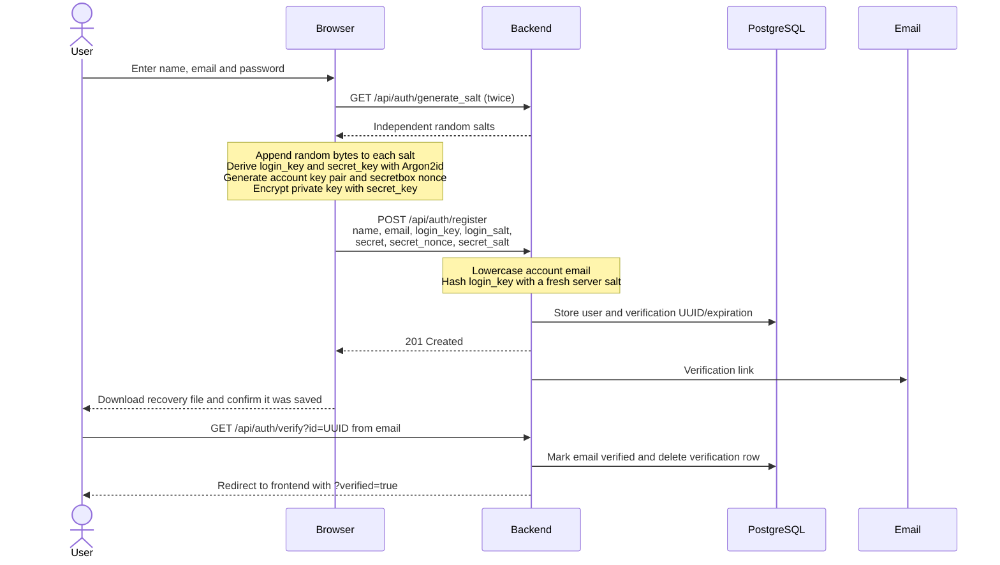
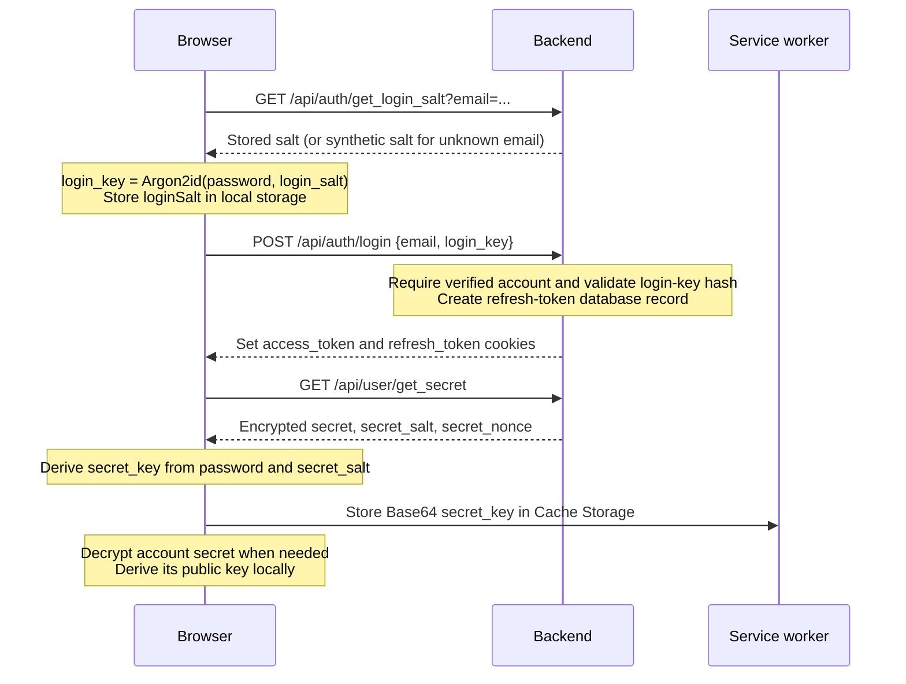
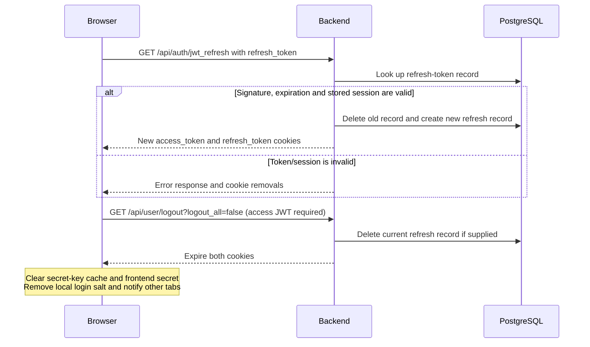
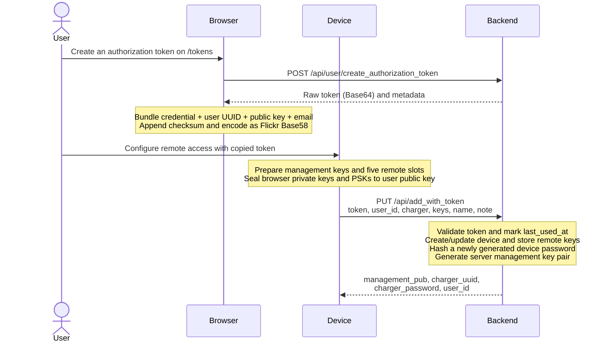
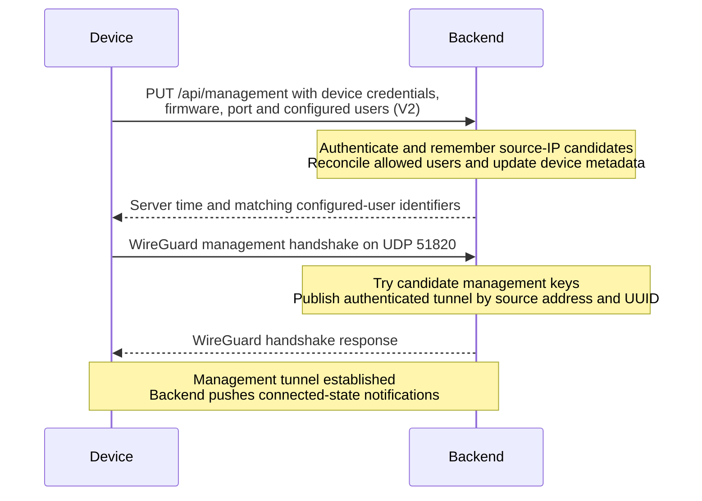

# Account and connection flows

These diagrams describe the current frontend and backend. All API paths include
the `/api` prefix used by the running server. Device-firmware internals live in
the separate `esp32-firmware` repository; device steps here describe the contract
expected by this server. See [data formats](data_type_definitions.md) for key
sizes/encoding and [architecture](entity_relations.md) for component boundaries.

## Registration and verification

The browser creates a box key pair, encrypts its private key with a
password-derived `secret_key`, and derives a separate `login_key`. Each salt is
24 server-generated bytes followed by 24 browser-generated bytes. The salt
endpoint retains no state and registration does not check salt provenance.



Names and emails are stored as plaintext; only the account private key is
secretbox-encrypted. Verification rows have a one-day lifetime. The periodic
cleanup task removes expired rows and unverified accounts without a remaining
verification row. `POST /api/auth/resend_verification` requests another email.

## Login



The access JWT lasts **6 minutes** and contains the user UUID in `sub`. The
refresh JWT lasts **60 days** and contains the refresh-token record UUID in
`sub`. Both cookies use `Secure`, `HttpOnly`, `SameSite=Strict`, path `/` and an
appended `Partitioned` attribute. The plaintext password is not submitted to the
backend.

## Refresh and logout



`logout_all=true` deletes all refresh records for the user. Access JWTs are
validated without a session-table lookup, so deleting refresh records alone does
not immediately revoke already issued access JWTs on other clients.

The frontend refreshes at a randomized interval of 3–5 minutes and retries API
requests after a 401. Browser Web Locks coordinate refresh calls; the service
worker can reuse a successful refresh response for three minutes.

## Register a device

A device can register using a user's access JWT (`PUT /api/charger/add`) or an
authorization token (`PUT /api/add_with_token`). The token bundles the raw
registration credential, user UUID, public key and email. Registration submits
management credentials and five remote-key entries, with browser private keys
and remote PSKs sealed to the user's public key.



Existing user/hardware-UID associations reuse their device UUID. Re-registration
replaces management credentials and deletes the device's stored remote keys
before inserting the newly supplied set. A copied token is distinct from the
raw Base64 credential sent to the API.

The older password-based setup uses `/auth/get_login_salt`, `/auth/login` and
`/user/get_secret` before submitting to `/charger/add`. The server supports it,
but the device UI implementing that sequence is outside this repository.

## Management connection



The current V2 envelope is `{"data":{"V2":{...}}}`. Device UUID/password reside
inside `V2`; legacy requests can provide numeric `id` and `password` at the top
level. See [api.md](api.md). The backend also supports subnet/forwarding-host
candidate selection and rate-limited global handshake searches.

A management V2 request updates names for known users and removes server-side
access/keys for users absent from the device's reported list. The response
returns matching UUIDs/emails (empty entries for unmatched users) for device-side
reconciliation. Management tunnel state is process-local and expires after
inactivity; cleanup checks run every ten seconds.

## Open a remote connection and discover its UDP port

```mermaid
sequenceDiagram
    participant Browser
    participant Worker as Dedicated worker / WASM
    participant Backend
    participant Device
    Browser->>Backend: GET /api/user/get_secret (if needed)
    Note over Browser: Decrypt account secret with cached secret_key
    Browser->>Backend: POST /api/charger/info {charger: UUID}
    Backend-->>Browser: Device port, MTU, firmware and connection state
    Browser->>Worker: Setup with account secret and device info
    Worker->>Backend: GET /api/charger/get_key?cid=UUID
    Backend-->>Worker: Available sealed key record and key ID
    Note over Worker: Open sealed private key and PSK<br/>Initialize WireGuard client
    Worker->>Backend: WebSocket upgrade /api/ws?key_id=UUID
    Note over Backend: Verify key ownership and availability<br/>Require an active management tunnel
    Backend->>Device: Connect command over management tunnel<br/>(connection number and random connection UUID)
    Backend-->>Worker: 101 Switching Protocols; reserve key in memory
    Device->>Backend: Discovery response from remote UDP socket<br/>(device UUID, connection number, connection UUID)
    Note over Backend: Match pending response and cache source address<br/>Remove pending discovery entry
    Worker->>Backend: Encrypted remote WireGuard packets as binary frames
    Backend->>Device: Forward encrypted UDP datagrams
    Device-->>Backend: Encrypted UDP response
    Backend-->>Worker: Forward binary WebSocket frames
    Note over Worker,Device: End-to-end WireGuard tunnel<br/>HTTP and inner WebSocket run through it
```

Pending connect commands are resent approximately every second and discovery
entries expire after 30 seconds (on periodic cleanup). Closing the relay
WebSocket releases its key and sends a management `Disconnect` command. If a
device re-identifies/reconnects, the backend attempts to rediscover saved browser
connection slots.

The iframe's HTTP requests pass through the service worker, frame and dedicated
worker. The initial HTML can come from the server's firmware cache; otherwise it
comes from the device. See the [request-path diagram](entity_relations.md).

## Change password

The browser retrieves/decrypts the existing account secret, derives new login
and secret keys with two new combined salts, and encrypts the **same account
secret** using a new nonce and the new `secret_key`.

```mermaid
sequenceDiagram
    participant Browser
    participant Backend
    Browser->>Backend: GET /api/user/get_secret and current login salt
    Note over Browser: Derive old login_key and decrypt existing account secret
    Browser->>Backend: GET /api/auth/generate_salt (twice)
    Note over Browser: Derive new login_key and secret_key<br/>Re-encrypt same account secret with new nonce
    Browser->>Backend: PUT /api/user/update_password<br/>old_login_key, new_login_key, new_login_salt,<br/>new_secret_nonce, new_secret_salt, new_encrypted_secret
    Note over Backend: Validate old_login_key<br/>Hash new_login_key and update account fields
    Backend-->>Browser: 200 OK
    Note over Browser: Frontend logs out all sessions; sign in with new password
```

The password-update handler itself does not delete refresh tokens; the frontend
performs logout afterward. Keeping the same account secret preserves sealed
device data and the existing recovery file.

## Change account email

`PUT /api/user/update_user` accepts `{name, email}` with an access JWT. Account
lookup uses a lowercase email, while `delivery_email` retains the submitted
spelling for mail delivery. When changing email, the backend saves the previous
email/delivery address, sets `email_verified=false`, creates a one-day
verification row, sends verification to the new address and notifies the old
address. Another email change while one is pending returns 409.

Following `/api/auth/verify?id=...` marks the account verified, clears the saved
old addresses and deletes the verification row. If the verification expires,
the minute-based cleanup removes the row and restores the previous addresses
and verified state. The account key and device keys do not change with the
email address. Login requires a verified account; changing email does not itself
delete existing refresh sessions.

Implementation: [update_user.rs](backend/src/routes/user/update_user.rs),
[verify.rs](backend/src/routes/auth/verify.rs),
[cleanup](backend/src/lib.rs).

## Password recovery

```mermaid
sequenceDiagram
    actor User
    participant Browser
    participant Backend
    participant Mail as Email
    Browser->>Backend: GET /api/auth/start_recovery?email=...
    Backend-->>Browser: 200 OK (also for unknown accounts)
    Backend->>Mail: Link to /recovery?token=UUID&email=...
    User->>Browser: Open link, enter new password, optionally load recovery file
    Browser->>Backend: POST /api/check_expiration {token_type: Recovery, token}
    Backend-->>Browser: Whether token record exists
    Browser->>Backend: GET /api/auth/generate_salt (twice)
    Note over Browser: Derive new keys/salts and generate nonce
    alt Valid recovery file supplied
        Note over Browser: Validate file checksum and reuse its account secret
    else No recovery file
        Browser-->>User: Confirm loss of existing device access
        Note over Browser: Generate a new account key pair
    end
    Note over Browser: Encrypt selected account secret with new secret_key
    Browser->>Backend: POST /api/auth/recovery<br/>recovery_key, new key/salt/nonce/ciphertext fields, reused_secret
    Note over Backend: Consume recovery-token record<br/>If secret changed: delete user's WG keys<br/>and mark allowed_users.valid=false<br/>Update credentials and set email_verified=true
    Backend-->>Browser: 200 OK
    Browser-->>User: Save recovery file; sign in with new password
```

There is no emailed temporary password. Recovery tokens older than six hours
are deleted by the minute-based cleanup task; verification rows use a one-day
expiration. `/check_expiration` and the recovery handler check record existence,
so expiry depends on that cleanup rather than an exact timestamp check in these
handlers. Recovery does not itself issue login cookies or revoke refresh tokens.

## Add or remove users/devices

`PUT /api/allow_user` takes device UUID/password, target user identity (`user_uuid`
or email), a `user_auth` value (`LoginKey` or `AuthToken`), five remote-key entries,
and sealed name/note. It authenticates both device and target user, then stores
the user/device association and keys. `/api/charger/allow_user` is a legacy alias
inside the JWT-protected charger scope.

For removal from the account page or device list, the following summarizes the
successful operation. `/charger/remove` sends the management notification before
deleting database rows; `/user/delete` sends it after deleting the user's
association and keys for each device.

```mermaid
sequenceDiagram
    participant Browser
    participant Backend
    participant Device
    Browser->>Backend: DELETE /api/charger/remove {charger: UUID}<br/>or DELETE /api/user/delete {login_key: [...]}
    Note over Backend: Remove user's allowed_users row and WG keys<br/>If no users remain, delete the device too
    alt Device has an active management tunnel
        Backend-->>Device: RemoveUser command containing user UUID
        Note over Device: Expected to remove user and keys locally
    else Device is offline
        Note over Backend: No push is queued; reconcile at next management request
    end
    Backend-->>Browser: 200 OK
```

Account deletion also deletes refresh sessions and the account; token/grouping
rows with cascading foreign keys are removed. A device can unregister itself
with `DELETE /api/selfdestruct` authenticated by its own UUID (or legacy numeric
UID) and password. This removes the device for all associated users.
